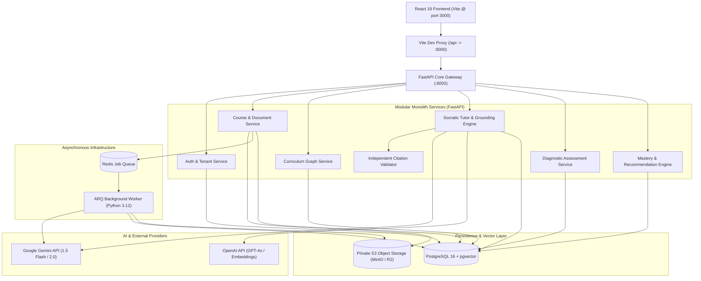

# System Architecture Specification

**Project:** CourseCompass Backend Platform  
**System Type:** Modular Monolith with Asynchronous Task Execution  
**Technology Stack:** FastAPI (Python 3.12), PostgreSQL 16 + pgvector, SQLAlchemy 2.0 (AsyncIO), Alembic, Redis + ARQ, S3-Compatible Object Storage, Google Gemini & OpenAI LLM Providers  
**Target Consumer:** Existing CourseCompass React / Vite Frontend  

---

## 1. System Overview & Architectural Principles

CourseCompass backend is architected as a **Modular Monolith**. It provides high development velocity, strictly enforced domain boundaries, zero inter-service network serialization overhead, and simple atomic database transactions, while keeping ingestion-heavy workloads off the HTTP request-response cycle via an asynchronous worker queue.



### Core Architectural Principles
1. **Frontend-Driven Domain Alignment:** All entity schemas and serialization pipelines directly adhere to the existing TypeScript contracts in `src/types/index.ts` using Pydantic `alias_generator = to_camel` and `populate_by_name = True`.
2. **Strict Tenant & Workspace Isolation:** Every single query beyond authentication is bound to `user_id` and verified against course ownership. Cross-student or cross-course leaks are strictly impossible at the repository layer.
3. **Audited Grounding & Non-Negotiable Boundaries:** The system treats LLM answers as untrusted drafts until an **Independent Verification Layer** certifies that every emitted citation matches an actual ingested chunk with $\ge 95\%$ semantic attribution.
4. **Asynchronous Heavy Lift:** Text extraction, OCR, diagram parsing, embedding generation, and graph induction never block the API event loop. They execute inside a dedicated worker process backed by Redis.

---

## 2. Subsystem & Domain Service Boundaries

```
app/
├── core/                  # Configuration, database session, security, exceptions
├── models/                # SQLAlchemy 2.0 mapped relational tables
├── schemas/               # Pydantic v2 schemas (camelCase serialization)
├── providers/             # Swappable third-party abstractions (LLM, Embeddings, S3)
│   ├── llm/               # BaseLLMProvider (GeminiProvider, OpenAIProvider)
│   ├── embeddings/        # BaseEmbeddingProvider (GeminiEmbedding, OpenAIEmbedding)
│   └── storage/           # BaseStorageProvider (S3StorageProvider)
├── services/              # Domain business logic
│   ├── auth_service.py
│   ├── course_service.py
│   ├── ingestion_service.py
│   ├── retrieval_service.py
│   ├── graph_service.py
│   ├── tutor_service.py
│   ├── validation_service.py
│   ├── quiz_service.py
│   └── mastery_service.py
├── workers/               # ARQ async background task definitions
└── api/v1/                # Route controllers grouped by resource
```

### 2.1 Authentication & Tenant Isolation (`AuthService`)
* **Responsibilities:** User signup, login, password hashing via `bcrypt`, access token generation using asymmetric `RS256` or secure `HS256` JWTs, and demo account simulation.
* **Tenant Isolation:** Enforces user ownership over `Course` records. Every course belongs to a `user_id`. Queries for documents, concepts, messages, and quizzes must verify the requesting user owns the parent course.

### 2.2 Course & Document Ingestion (`CourseService`, `IngestionService`)
* **Responsibilities:** Create courses, manage metadata (exam date, target minutes), handle multi-file uploads (`multipart/form-data`), stream binary streams into private S3 buckets, and dispatch parsing jobs to Redis.
* **Stage Tracking:** Manages an atomic state machine for document processing (`uploaded` $\to$ `processing` $\to$ `indexed` / `failed`) with an exact 7-stage breakdown matching the frontend visual indicator in `CourseCreationWorkspace.tsx`:
  1. `secure_upload`: Validating cryptographic container and file signature.
  2. `reading_content`: Extracting formatted text, headings, and code blocks.
  3. `understanding_diagrams`: Analyzing whiteboard diagrams and visual trees.
  4. `transcribing_lecture`: Processing timestamped lecture transcripts.
  5. `finding_concepts`: Isolating key topics, theorems, and definitions.
  6. `building_prerequisites`: Constructing dependency edges between concepts.
  7. `ready`: Generating diagnostic quiz seeds and flashcard summaries.

### 2.3 Chunking, Embeddings & Vector Search (`RetrievalService`)
* **Chunking Strategy:** Recursive character splitting with heading-aware boundaries. Chunk sizes: $500\text{ tokens}$ with $60\text{ token}$ overlap.
* **Vector Store:** PostgreSQL with `pgvector` extension.
* **Embedding Dimension:** $768$ (Google `text-embedding-004`) or $1536$ (OpenAI `text-embedding-3-small`). Configurable via environment variable.
* **Search Mechanics:** Hybrid retrieval combining:
  * Dense semantic similarity via pgvector cosine distance (`<=>`).
  * Sparse exact matching via PostgreSQL Full-Text Search (`tsvector` on chunk text).
  * Hard metadata filtering: `WHERE course_id = :course_id`.

### 2.4 Curriculum & Prerequisite Graph Engine (`GraphService`)
* **Data Model:** Normalized relational representation of Directed Acyclic Graphs (DAGs).
  * `Topic` nodes represent broad curriculum modules.
  * `Concept` nodes represent atomic learning objectives with defined `difficulty` (`Foundational`, `Intermediate`, `Advanced`).
  * `ConceptRelationship` edges define `prerequisite`, `component`, and `extension` links.
* **Graph Induction:** During material ingestion, Gemini analyzes cross-chapter references and induces candidate prerequisite edges, validated by topological cycle-detection before persisting.

### 2.5 Grounded Socratic Tutor & Multi-Provider Engine (`TutorService`)
* **Conversational Interface:** Manages user dialogue threads bound to active courses.
* **The 4 Explicit Answer States:**
  1. `supported`: Retrieved chunks contain direct, unambiguous proof for the query.
  2. `partially_supported`: Partial evidence is available; boundaries are noted.
  3. `not_found`: Maximum similarity score across all course chunks is $< 0.62$. The system triggers the **Boundary Guard**, refusing to hallucinate and offering outside explanation or missing slide uploads.
  4. `outside_materials`: Explicitly requested general explanation, visually flagged as ungrounded in courseware.
* **Multi-Provider Architecture:** Configurable between Google Gemini and OpenAI through an abstract `BaseLLMProvider`.

### 2.6 Independent Verification Layer (`ValidationService`)
* **Role:** A dedicated validator pipeline that inspects every draft response generated by `TutorService` before delivery to the frontend.
* **Verification Algorithm:**
  1. Extracts each citation claim and its target `[CHUNK: id=...]` reference.
  2. Fetches the raw document page chunk from PostgreSQL.
  3. Uses a lightweight secondary LLM pass (or strict NLI/embedding entailment model) to score claim-to-chunk entailment.
  4. If attribution score $\ge 0.90$, tags `verificationConfidence = 'verified'`.
  5. If attribution score is below threshold, strips the unverified citation or forces the answer state to `partially_supported` with an `unsupportedWarning`.

### 2.7 Diagnostic Assessment & Misconception Engine (`QuizService`)
* **Targeted Generation:** Produces multiple-choice questions dynamically grounded in specific indexed concepts.
* **Misconception Traps:** Each question distractor is explicitly engineered to reflect real student mental model errors (e.g., confusing DFS call stack Gray vertices with visited Black vertices).
* **Grading & Feedback:** Evaluates student submissions, explains why distractors were chosen, and outputs direct citation links to the course source.

### 2.8 Deterministic Mastery & Prescriptive Study Planner (`MasteryService`)
* **Mastery Formulation:** Calculates concept mastery deterministically:
  $$M_{concept} = w_1 \cdot S_{quiz} + w_2 \cdot S_{sprint} + w_3 \cdot M_{prereq}$$
  * No arbitrary LLM guessing of student scores.
  * Correct diagnostic submissions increment mastery by calculated deltas ($+10\%\text{–}+14\%$).
* **Prerequisite Propagation:** If a student fails a foundational concept ($M < 50\%$), dependent downstream concepts are blocked from `mastered` status and flagged with warning badges.
* **"Study Next" Prescription:** Ranks all course concepts by urgency score:
  $$\text{Urgency} = (1.0 - M_{concept}) \times \text{OutDegree}(concept) \times \frac{1}{\text{DaysToExam}}$$
  Prescribes the single highest-yield study blocker to display on the student dashboard.

---

## 3. Provider Abstraction Layer

To ensure vendor independence and compliance with the specification, all external AI and storage services are accessed via abstract interfaces:

```python
# app/providers/llm/base.py
from abc import ABC, abstractmethod
from pydantic import BaseModel

class LLMCompletionRequest(BaseModel):
    system_prompt: str
    user_prompt: str
    temperature: float = 0.2
    max_tokens: int = 1500

class LLMCompletionResponse(BaseModel):
    content: str
    model_name: str
    prompt_tokens: int
    completion_tokens: int

class BaseLLMProvider(ABC):
    @abstractmethod
    async def generate_completion(self, request: LLMCompletionRequest) -> LLMCompletionResponse:
        pass

    @abstractmethod
    async def generate_structured(self, request: LLMCompletionRequest, schema: type[BaseModel]) -> BaseModel:
        pass
```

Implementations:
* `GeminiProvider` (`google-genai` SDK using `gemini-1.5-flash` / `gemini-2.0-flash`)
* `OpenAIProvider` (`openai` Python SDK using `gpt-4o` / `gpt-4o-mini`)
* Configured via environment variable `LLM_PROVIDER=gemini|openai` and `VALIDATOR_PROVIDER=gemini|openai`.

---

## 4. Asynchronous Worker Architecture (ARQ & Redis)

For ingestion, PDF parsing, OCR, and embedding generation, FastAPI delegates tasks to **ARQ**, an ultra-fast, lightweight async job queue built specifically for Python `asyncio` and Redis.

```
[FastAPI Route: /courses/{id}/materials]
       │
       ▼ (writes file to S3 & metadata to Postgres)
[Enqueues job: redis.enqueue_job("process_document_job", doc_id)]
       │
       ▼ (HTTP 202 Accepted returned in < 250ms)
[ARQ Worker Process]
       ├── Step 1: Read binary stream from S3
       ├── Step 2: PyPDF / OCR text and headings extraction
       ├── Step 3: Chunking & Gemini Embedding generation
       ├── Step 4: Bulk insert chunks & vectors into PostgreSQL pgvector
       ├── Step 5: Concept extraction & prerequisite link deduction
       └── Step 6: Atomic update of document status to 'indexed'
```

---

## 5. Security, Tenant Isolation & Data Governance

1. **Password Security:** Passwords hashed with `bcrypt` (12 rounds) via `passlib[bcrypt]`.
2. **Session Tokens:** Stateless JWT tokens signed with server secret, with 8-hour expiry matching frontend `expiresAt` contract.
3. **S3 Private Storage:** Buckets are strictly private. Files are uploaded via temporary pre-signed S3 URLs or streamed through the backend ingestion gateway.
4. **Tenant Isolation:** Repository queries enforce `WHERE course.user_id = :current_user_id`. Attempting to access unauthorized courses results in an immediate HTTP 403 Forbidden.
5. **No Secrets in Frontend:** API keys (`GEMINI_API_KEY`, `OPENAI_API_KEY`, `AWS_SECRET_ACCESS_KEY`) exist solely within backend `.env` variables and are never surfaced to the browser.

