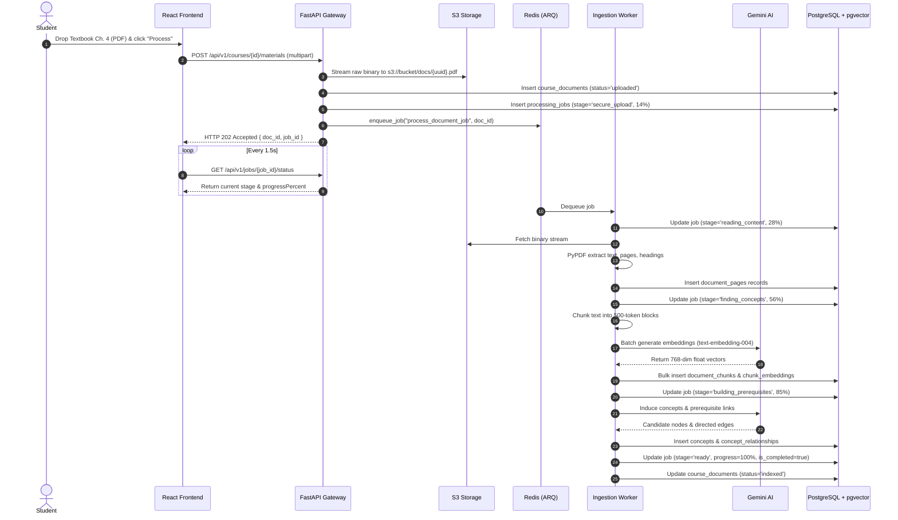
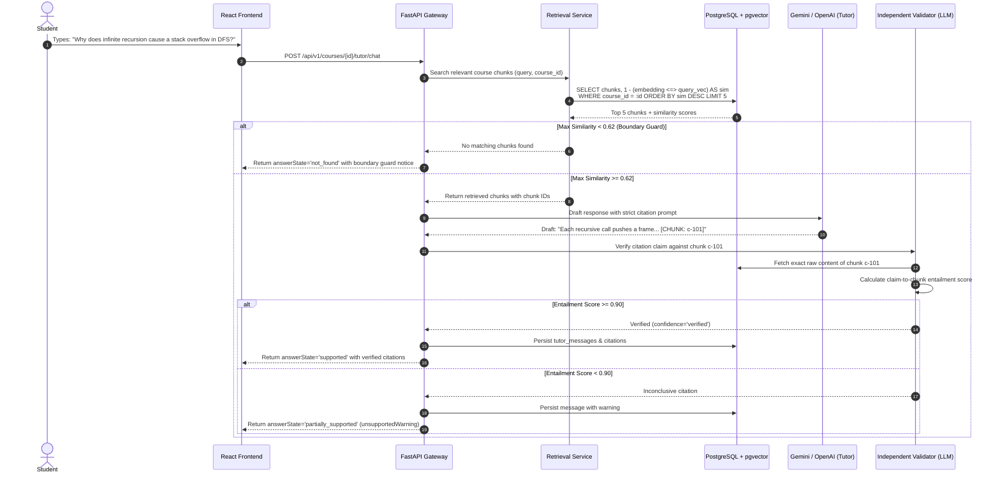
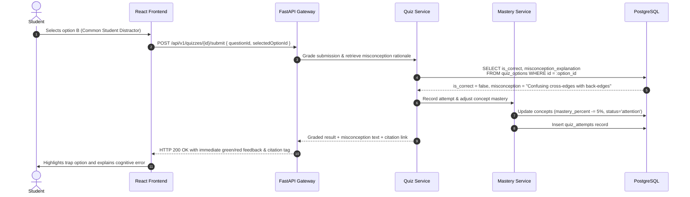
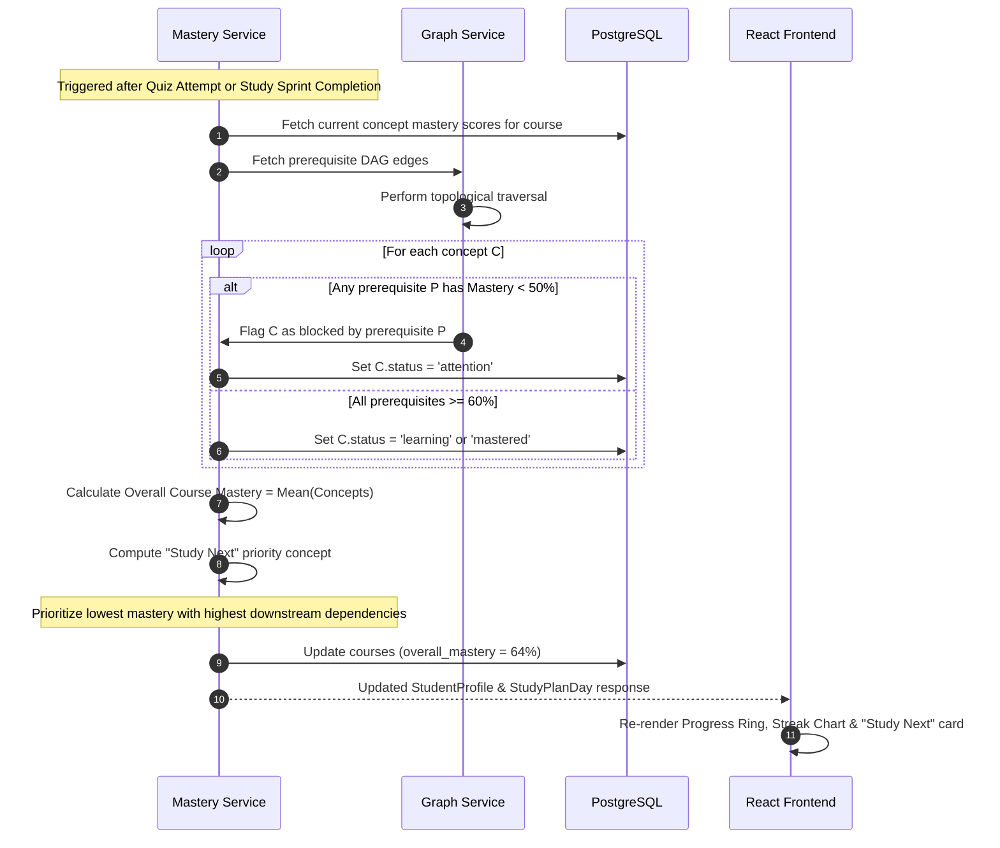

# End-to-End Data Flow Specifications

**Project:** CourseCompass  
**Focus:** Sequence-Level Execution Tracing & State Transitions  

---

## 1. Document Ingestion & Asynchronous Indexing Flow

---

## 2. Grounded Socratic Tutor & Independent Citation Validation Flow

---

## 3. Diagnostic Assessment & Misconception Evaluation Flow

---

## 4. Deterministic Mastery Calculation & "Study Next" Propagation

