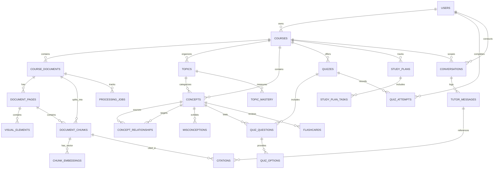

# Database Architecture & Relational Schema Design

**Database Engine:** PostgreSQL 16+  
**Extensions:** `uuid-ossp`, `pgcrypto`, `vector` (pgvector 0.7+)  
**ORM:** SQLAlchemy 2.0 (AsyncIO)  
**Migration Tool:** Alembic  

---

## 1. Entity-Relationship Model (ERD)



---

## 2. Table Specifications & DDL Schemas

### 2.1 Identity & Tenant Isolation

```sql
-- Core users table
CREATE TABLE users (
    id UUID PRIMARY KEY DEFAULT gen_random_uuid(),
    email VARCHAR(255) NOT NULL UNIQUE,
    hashed_password VARCHAR(255) NOT NULL,
    full_name VARCHAR(150) NOT NULL,
    academic_level VARCHAR(100) DEFAULT 'Undergraduate',
    institution VARCHAR(255) DEFAULT 'University College',
    avatar_url VARCHAR(500),
    is_active BOOLEAN NOT NULL DEFAULT TRUE,
    is_superuser BOOLEAN NOT NULL DEFAULT FALSE,
    is_demo_user BOOLEAN NOT NULL DEFAULT FALSE,
    created_at TIMESTAMPTZ NOT NULL DEFAULT NOW(),
    updated_at TIMESTAMPTZ NOT NULL DEFAULT NOW()
);

CREATE INDEX idx_users_email ON users(email);
```

---

### 2.2 Courses & Document Corpus

```sql
-- Student course workspaces
CREATE TABLE courses (
    id UUID PRIMARY KEY DEFAULT gen_random_uuid(),
    user_id UUID NOT NULL REFERENCES users(id) ON DELETE CASCADE,
    name VARCHAR(255) NOT NULL,
    code VARCHAR(50) NOT NULL,
    subject VARCHAR(100) NOT NULL,
    exam_date DATE,
    daily_study_minutes INT NOT NULL DEFAULT 45,
    overall_mastery INT NOT NULL DEFAULT 0 CHECK (overall_mastery BETWEEN 0 AND 100),
    is_active BOOLEAN NOT NULL DEFAULT TRUE,
    created_at TIMESTAMPTZ NOT NULL DEFAULT NOW(),
    updated_at TIMESTAMPTZ NOT NULL DEFAULT NOW(),
    CONSTRAINT uq_user_course_code UNIQUE (user_id, code)
);

CREATE INDEX idx_courses_user_id ON courses(user_id);

-- Uploaded course documents (PDF, Slides, Video Transcripts, Notes)
CREATE TABLE course_documents (
    id UUID PRIMARY KEY DEFAULT gen_random_uuid(),
    course_id UUID NOT NULL REFERENCES courses(id) ON DELETE CASCADE,
    title VARCHAR(300) NOT NULL,
    document_type VARCHAR(50) NOT NULL CHECK (document_type IN ('pdf', 'video', 'slides', 'audio', 'image', 'notes')),
    s3_storage_key VARCHAR(500) NOT NULL,
    file_size_bytes BIGINT NOT NULL DEFAULT 0,
    formatted_size VARCHAR(50),
    page_count_or_duration VARCHAR(100),
    status VARCHAR(50) NOT NULL DEFAULT 'uploaded' CHECK (status IN ('uploaded', 'processing', 'indexed', 'failed', 'ready')),
    summary TEXT,
    error_message TEXT,
    created_at TIMESTAMPTZ NOT NULL DEFAULT NOW(),
    updated_at TIMESTAMPTZ NOT NULL DEFAULT NOW()
);

CREATE INDEX idx_documents_course_id ON course_documents(course_id);
CREATE INDEX idx_documents_status ON course_documents(status);

-- Real-time 7-stage processing job tracking
CREATE TABLE processing_jobs (
    id UUID PRIMARY KEY DEFAULT gen_random_uuid(),
    document_id UUID NOT NULL REFERENCES course_documents(id) ON DELETE CASCADE,
    stage VARCHAR(50) NOT NULL CHECK (stage IN (
        'secure_upload',
        'reading_content',
        'understanding_diagrams',
        'transcribing_lecture',
        'finding_concepts',
        'building_prerequisites',
        'ready'
    )),
    stage_number INT NOT NULL DEFAULT 1,
    total_stages INT NOT NULL DEFAULT 7,
    stage_description VARCHAR(255) NOT NULL,
    progress_percent INT NOT NULL DEFAULT 0 CHECK (progress_percent BETWEEN 0 AND 100),
    is_completed BOOLEAN NOT NULL DEFAULT FALSE,
    error_log TEXT,
    created_at TIMESTAMPTZ NOT NULL DEFAULT NOW(),
    updated_at TIMESTAMPTZ NOT NULL DEFAULT NOW()
);

CREATE INDEX idx_processing_jobs_doc_id ON processing_jobs(document_id);
```

---

### 2.3 Document Pages, Visual Elements & Vector Chunks

```sql
-- Physical pages or slide numbers
CREATE TABLE document_pages (
    id UUID PRIMARY KEY DEFAULT gen_random_uuid(),
    document_id UUID NOT NULL REFERENCES course_documents(id) ON DELETE CASCADE,
    page_number INT NOT NULL,
    slide_number INT,
    timestamp_seconds INT,
    raw_text TEXT NOT NULL,
    cleaned_text TEXT,
    created_at TIMESTAMPTZ NOT NULL DEFAULT NOW()
);

CREATE INDEX idx_doc_pages_doc_num ON document_pages(document_id, page_number);

-- Visual diagrams, charts, and whiteboard figures
CREATE TABLE visual_elements (
    id UUID PRIMARY KEY DEFAULT gen_random_uuid(),
    page_id UUID NOT NULL REFERENCES document_pages(id) ON DELETE CASCADE,
    element_type VARCHAR(50) NOT NULL CHECK (element_type IN ('diagram', 'figure', 'chart', 'whiteboard', 'table')),
    s3_image_key VARCHAR(500) NOT NULL,
    caption TEXT,
    ocr_extracted_text TEXT,
    bounding_box_json JSONB,
    created_at TIMESTAMPTZ NOT NULL DEFAULT NOW()
);

CREATE INDEX idx_visual_elements_page ON visual_elements(page_id);

-- Semantic vector chunks for RAG
CREATE TABLE document_chunks (
    id UUID PRIMARY KEY DEFAULT gen_random_uuid(),
    document_id UUID NOT NULL REFERENCES course_documents(id) ON DELETE CASCADE,
    page_id UUID REFERENCES document_pages(id) ON DELETE SET NULL,
    chunk_index INT NOT NULL,
    content TEXT NOT NULL,
    token_count INT NOT NULL,
    location_label VARCHAR(150) NOT NULL, -- e.g. "Chapter 4, Page 112" or "Timestamp 14:32"
    page_number INT,
    slide_number INT,
    timestamp_seconds INT,
    tsv_content TSVECTOR GENERATED ALWAYS AS (to_tsvector('english', content)) STORED,
    created_at TIMESTAMPTZ NOT NULL DEFAULT NOW()
);

CREATE INDEX idx_chunks_doc_id ON document_chunks(document_id);
CREATE INDEX idx_chunks_tsv ON document_chunks USING GIN(tsv_content);

-- Vector embeddings table using pgvector
CREATE TABLE chunk_embeddings (
    chunk_id UUID PRIMARY KEY REFERENCES document_chunks(id) ON DELETE CASCADE,
    embedding_model VARCHAR(100) NOT NULL, -- 'text-embedding-004' (768) or 'text-embedding-3-small' (1536)
    embedding VECTOR(768) NOT NULL, -- Configured for 768-dim embeddings
    created_at TIMESTAMPTZ NOT NULL DEFAULT NOW()
);

-- HNSW Index for ultra-fast approximate nearest neighbor cosine search
CREATE INDEX idx_chunk_embeddings_hnsw ON chunk_embeddings USING hnsw (embedding vector_cosine_ops)
WITH (m = 16, ef_construction = 64);
```

---

### 2.4 Curriculum, Prerequisite Graph & Misconceptions

```sql
-- Curriculum module topics
CREATE TABLE topics (
    id UUID PRIMARY KEY DEFAULT gen_random_uuid(),
    course_id UUID NOT NULL REFERENCES courses(id) ON DELETE CASCADE,
    title VARCHAR(255) NOT NULL,
    description TEXT,
    sort_order INT NOT NULL DEFAULT 1,
    created_at TIMESTAMPTZ NOT NULL DEFAULT NOW(),
    updated_at TIMESTAMPTZ NOT NULL DEFAULT NOW()
);

CREATE INDEX idx_topics_course ON topics(course_id);

-- Atomic concepts
CREATE TABLE concepts (
    id UUID PRIMARY KEY DEFAULT gen_random_uuid(),
    course_id UUID NOT NULL REFERENCES courses(id) ON DELETE CASCADE,
    topic_id UUID REFERENCES topics(id) ON DELETE SET NULL,
    name VARCHAR(255) NOT NULL,
    difficulty VARCHAR(50) NOT NULL DEFAULT 'Foundational' CHECK (difficulty IN ('Foundational', 'Intermediate', 'Advanced')),
    mastery_percent INT NOT NULL DEFAULT 0 CHECK (mastery_percent BETWEEN 0 AND 100),
    status VARCHAR(50) NOT NULL DEFAULT 'learning' CHECK (status IN ('mastered', 'learning', 'attention', 'locked')),
    summary TEXT NOT NULL,
    primary_misconception TEXT NOT NULL,
    created_at TIMESTAMPTZ NOT NULL DEFAULT NOW(),
    updated_at TIMESTAMPTZ NOT NULL DEFAULT NOW()
);

CREATE INDEX idx_concepts_course ON concepts(course_id);
CREATE INDEX idx_concepts_status ON concepts(status);

-- Directed dependency edges (DAG)
CREATE TABLE concept_relationships (
    id UUID PRIMARY KEY DEFAULT gen_random_uuid(),
    source_concept_id UUID NOT NULL REFERENCES concepts(id) ON DELETE CASCADE, -- Prerequisite
    target_concept_id UUID NOT NULL REFERENCES concepts(id) ON DELETE CASCADE, -- Dependent
    relationship_type VARCHAR(50) NOT NULL DEFAULT 'prerequisite' CHECK (relationship_type IN ('prerequisite', 'component', 'extension')),
    created_at TIMESTAMPTZ NOT NULL DEFAULT NOW(),
    CONSTRAINT uq_concept_edge UNIQUE (source_concept_id, target_concept_id),
    CONSTRAINT chk_no_self_loop CHECK (source_concept_id <> target_concept_id)
);

CREATE INDEX idx_relationships_source ON concept_relationships(source_concept_id);
CREATE INDEX idx_relationships_target ON concept_relationships(target_concept_id);

-- Known student misconceptions linked to concepts
CREATE TABLE misconceptions (
    id UUID PRIMARY KEY DEFAULT gen_random_uuid(),
    concept_id UUID NOT NULL REFERENCES concepts(id) ON DELETE CASCADE,
    student_confusion TEXT NOT NULL,
    diagnostic_advice TEXT NOT NULL,
    created_at TIMESTAMPTZ NOT NULL DEFAULT NOW()
);

CREATE INDEX idx_misconceptions_concept ON misconceptions(concept_id);
```

---

### 2.5 Socratic Tutor, Messages & Verified Citations

```sql
-- Multi-turn conversations
CREATE TABLE conversations (
    id UUID PRIMARY KEY DEFAULT gen_random_uuid(),
    course_id UUID NOT NULL REFERENCES courses(id) ON DELETE CASCADE,
    user_id UUID NOT NULL REFERENCES users(id) ON DELETE CASCADE,
    title VARCHAR(255) NOT NULL DEFAULT 'Study Session',
    created_at TIMESTAMPTZ NOT NULL DEFAULT NOW(),
    updated_at TIMESTAMPTZ NOT NULL DEFAULT NOW()
);

CREATE INDEX idx_conversations_course_user ON conversations(course_id, user_id);

-- Individual chat messages
CREATE TABLE tutor_messages (
    id UUID PRIMARY KEY DEFAULT gen_random_uuid(),
    conversation_id UUID NOT NULL REFERENCES conversations(id) ON DELETE CASCADE,
    sender VARCHAR(20) NOT NULL CHECK (sender IN ('user', 'tutor')),
    text TEXT NOT NULL,
    explanation_level VARCHAR(50) DEFAULT 'rigorous' CHECK (explanation_level IN ('introductory', 'rigorous', 'exam_prep')),
    answer_state VARCHAR(50) CHECK (answer_state IN ('supported', 'partially_supported', 'not_found', 'outside_materials')),
    unsupported_warning TEXT,
    concept_id UUID REFERENCES concepts(id) ON DELETE SET NULL,
    created_at TIMESTAMPTZ NOT NULL DEFAULT NOW()
);

CREATE INDEX idx_tutor_messages_conversation ON tutor_messages(conversation_id);

-- Verified source citations linked to messages or quiz explanations
CREATE TABLE citations (
    id UUID PRIMARY KEY DEFAULT gen_random_uuid(),
    message_id UUID REFERENCES tutor_messages(id) ON DELETE CASCADE,
    chunk_id UUID REFERENCES document_chunks(id) ON DELETE CASCADE,
    source_title VARCHAR(300) NOT NULL,
    source_type VARCHAR(50) NOT NULL,
    location_label VARCHAR(150) NOT NULL,
    page_number INT,
    slide_number INT,
    timestamp_seconds INT,
    excerpt TEXT NOT NULL,
    context_snippet TEXT NOT NULL,
    verification_confidence VARCHAR(50) NOT NULL DEFAULT 'verified' CHECK (verification_confidence IN ('verified', 'partial', 'inconclusive')),
    created_at TIMESTAMPTZ NOT NULL DEFAULT NOW()
);

CREATE INDEX idx_citations_message ON citations(message_id);
CREATE INDEX idx_citations_chunk ON citations(chunk_id);
```

---

### 2.6 Adaptive Quizzes, Attempts & Mastery

```sql
-- Quizzes
CREATE TABLE quizzes (
    id UUID PRIMARY KEY DEFAULT gen_random_uuid(),
    course_id UUID NOT NULL REFERENCES courses(id) ON DELETE CASCADE,
    title VARCHAR(255) NOT NULL,
    concept_id UUID REFERENCES concepts(id) ON DELETE SET NULL,
    difficulty VARCHAR(50) DEFAULT 'Intermediate',
    created_at TIMESTAMPTZ NOT NULL DEFAULT NOW()
);

-- Questions
CREATE TABLE quiz_questions (
    id UUID PRIMARY KEY DEFAULT gen_random_uuid(),
    quiz_id UUID NOT NULL REFERENCES quizzes(id) ON DELETE CASCADE,
    concept_id UUID NOT NULL REFERENCES concepts(id) ON DELETE CASCADE,
    prompt TEXT NOT NULL,
    code_snippet TEXT,
    question_type VARCHAR(50) NOT NULL DEFAULT 'multiple_choice',
    difficulty VARCHAR(50) NOT NULL DEFAULT 'Intermediate',
    explanation TEXT NOT NULL,
    citation_id UUID REFERENCES citations(id) ON DELETE SET NULL,
    created_at TIMESTAMPTZ NOT NULL DEFAULT NOW()
);

-- Multiple choice options with misconception diagnosis
CREATE TABLE quiz_options (
    id UUID PRIMARY KEY DEFAULT gen_random_uuid(),
    question_id UUID NOT NULL REFERENCES quiz_questions(id) ON DELETE CASCADE,
    option_text TEXT NOT NULL,
    is_correct BOOLEAN NOT NULL DEFAULT FALSE,
    misconception_explanation TEXT,
    sort_order INT NOT NULL DEFAULT 1
);

CREATE INDEX idx_quiz_options_question ON quiz_options(question_id);

-- Student attempts & results
CREATE TABLE quiz_attempts (
    id UUID PRIMARY KEY DEFAULT gen_random_uuid(),
    quiz_id UUID NOT NULL REFERENCES quizzes(id) ON DELETE CASCADE,
    user_id UUID NOT NULL REFERENCES users(id) ON DELETE CASCADE,
    course_id UUID NOT NULL REFERENCES courses(id) ON DELETE CASCADE,
    started_at TIMESTAMPTZ NOT NULL DEFAULT NOW(),
    completed_at TIMESTAMPTZ,
    score_percent INT NOT NULL DEFAULT 0,
    total_questions INT NOT NULL DEFAULT 0,
    correct_count INT NOT NULL DEFAULT 0,
    mastery_gain_percent INT NOT NULL DEFAULT 0,
    status VARCHAR(50) NOT NULL DEFAULT 'completed' CHECK (status IN ('in_progress', 'completed'))
);

CREATE INDEX idx_quiz_attempts_user_course ON quiz_attempts(user_id, course_id);
```

---

### 2.7 Study Plans & Topic Mastery

```sql
-- Topic-level aggregated mastery
CREATE TABLE topic_mastery (
    id UUID PRIMARY KEY DEFAULT gen_random_uuid(),
    topic_id UUID NOT NULL REFERENCES topics(id) ON DELETE CASCADE,
    user_id UUID NOT NULL REFERENCES users(id) ON DELETE CASCADE,
    mastery_percent INT NOT NULL DEFAULT 0,
    concepts_total INT NOT NULL DEFAULT 0,
    concepts_mastered INT NOT NULL DEFAULT 0,
    concepts_developing INT NOT NULL DEFAULT 0,
    concepts_attention INT NOT NULL DEFAULT 0,
    updated_at TIMESTAMPTZ NOT NULL DEFAULT NOW(),
    CONSTRAINT uq_user_topic_mastery UNIQUE (user_id, topic_id)
);

-- Adaptive calendar study plans
CREATE TABLE study_plans (
    id UUID PRIMARY KEY DEFAULT gen_random_uuid(),
    course_id UUID NOT NULL REFERENCES courses(id) ON DELETE CASCADE,
    user_id UUID NOT NULL REFERENCES users(id) ON DELETE CASCADE,
    day_number INT NOT NULL,
    date_string VARCHAR(50) NOT NULL,
    focus_concept_id UUID REFERENCES concepts(id) ON DELETE SET NULL,
    focus_title VARCHAR(255) NOT NULL,
    minutes_budget INT NOT NULL DEFAULT 45,
    status VARCHAR(50) NOT NULL DEFAULT 'scheduled' CHECK (status IN ('completed', 'in-progress', 'scheduled')),
    created_at TIMESTAMPTZ NOT NULL DEFAULT NOW()
);

-- Sub-tasks within a study plan day
CREATE TABLE study_plan_tasks (
    id UUID PRIMARY KEY DEFAULT gen_random_uuid(),
    study_plan_id UUID NOT NULL REFERENCES study_plans(id) ON DELETE CASCADE,
    title VARCHAR(255) NOT NULL,
    duration_minutes INT NOT NULL DEFAULT 15,
    completed BOOLEAN NOT NULL DEFAULT FALSE,
    task_type VARCHAR(50) NOT NULL DEFAULT 'tutor' CHECK (task_type IN ('tutor', 'quiz', 'flashcard', 'reading')),
    target_citation_id UUID REFERENCES citations(id) ON DELETE SET NULL,
    created_at TIMESTAMPTZ NOT NULL DEFAULT NOW()
);

CREATE INDEX idx_study_plan_tasks ON study_plan_tasks(study_plan_id);
```

---

## 3. Migration Strategy (Alembic)

1. **Bootstrap Migration:** `0001_initial_schema.py` enables `uuid-ossp` and `vector` extensions and generates all initial normalized tables.
2. **Versioned Upgrades:** Every schema change is codified in an Alembic revision tested against a local staging database before deployment.
3. **Rollback Safety:** All migrations provide an explicit `downgrade()` implementation that reverses table creations without corrupting global database state.

